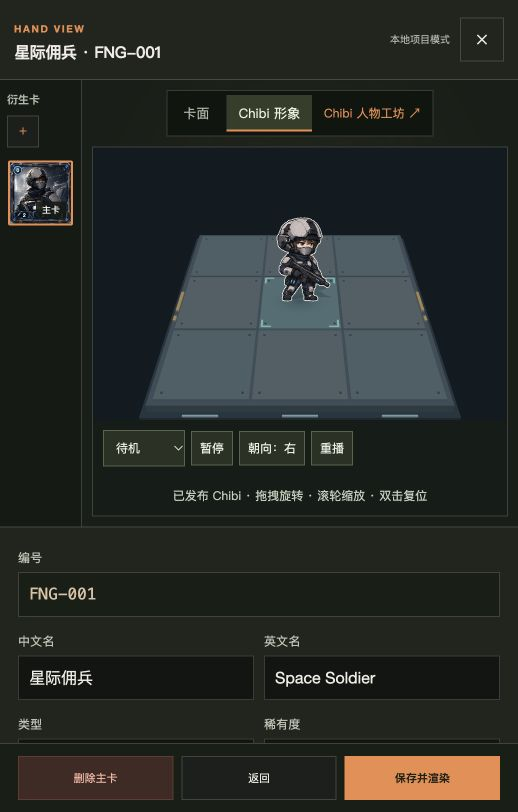

# 新版 Chibi 网站整合验收

任务：https://github.com/Time-Block-Hero/time-block-hero-unified/issues/165

## 范围与来源

2026-11-22 用户完成 Chibi 校准，明确要求新版进入 Website 与卡牌编辑器，并删除旧页面、入口和历史试稿。本次仅 Website；卡牌设计、Unity 运行包及线上部署不在变更范围内。

源校准：30 个单位调整；99 套完整发布。`data/chibi-workbench.json` SHA-256：`f2d7167c82fbc483021526a62483ead7068a954553e305155cd0567ed6ea8a7c`。发布来源提交 `4445046` 已包含这份校准，发布清单另记完整来源 SHA、图集 SHA 与修补参数。

## 清理

删除 316 个旧页面、工具、索引和资产文件，共 366,351,516 字节（约349.4 MiB），包括99份旧静态立绘、99套十二帧图集，以及谕晶/「革命日」两组未引用的历史版本。该数字为删除文件大小，不是 Git 对象库释放量；不重写 Git 历史。

当前99套九帧原稿、生成来源、校准、发布产物与必要历史验收记录保留。当前 `assets/chibi-review/` 是生产发布依赖，不能整目录删除。旧 `chibi-gallery.html`、`chibi-review.html` 返回404，当前入口无跳转依赖。

## 验证

- `npm run build` 通过；`npm test` 119/119 通过（包括8项新的预览/生命周期回归）。旧同步/旧渲染器专属测试随机制退休，保留离线卡牌初始化、保存不回写旧素材索引和当前源稿校验。
- `node tools/publish-chibi-workbench.mjs --check`、`node tools/export-chibi-workbench.mjs --check` 均验证99套通过。
- 本地浏览器：普通随从与裂隙惘生德雷克衍生UID均加载已发布素材；移动、暂停、翻向有效；卡面/Chibi切换保留临时未保存卡文，未提交测试文本；法术无Chibi页签；浏览器无error日志。
- 默认1280×720窗口视觉检查：棋盘、人物、切换页签和控件可见。没有声称移动设备验收。
- 原始工作区 `data/cards.json` 哈希前后相同；`data/chibi-workbench.json` 与用户已保存文件逐字节相同。离线卡牌数据按本地现有卡牌重建，没有用主线旧卡文覆盖用户设计。

## 交付与边界

独立Website PR，未自动合并或部署。与卡牌改版PR #31都修改生成文件 `card-editor-data.js`；合并产生冲突时以保留后的 `data/cards.json` 运行 `node tools/build-card-editor-fallback.mjs` 重建，禁止以旧生成文件覆盖新卡牌源。

最终本地编辑器界面：

