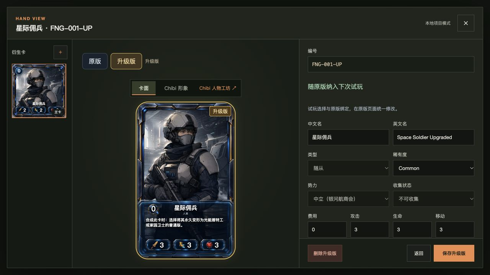
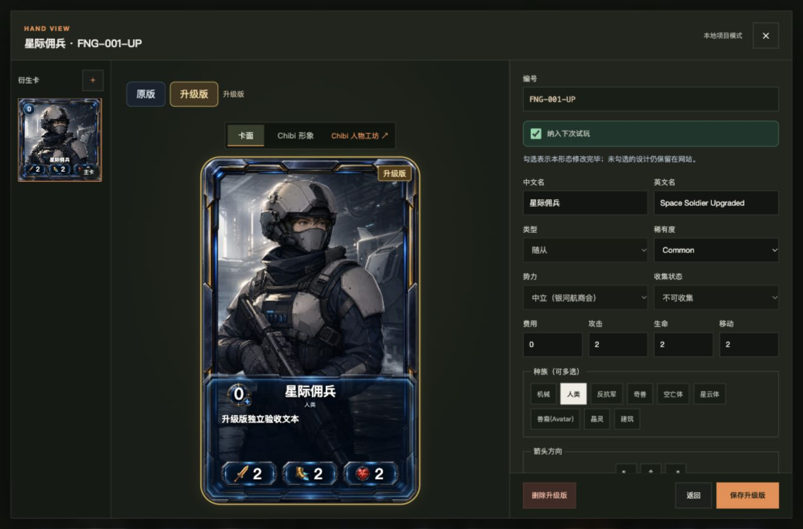
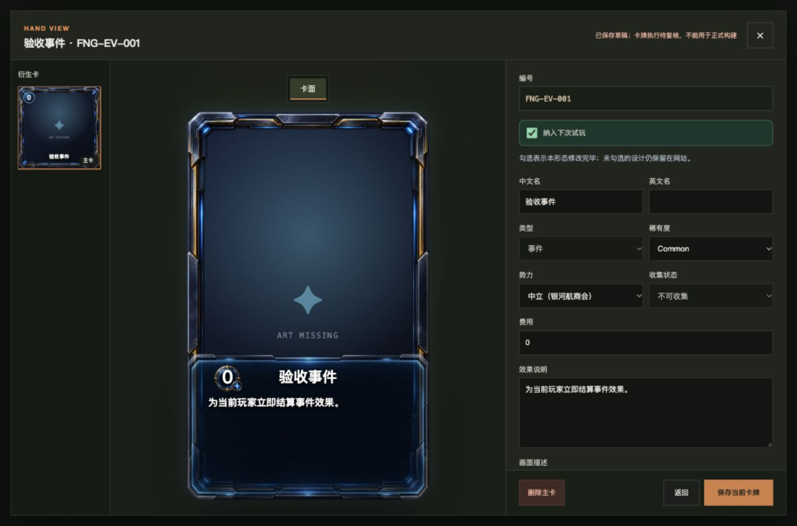
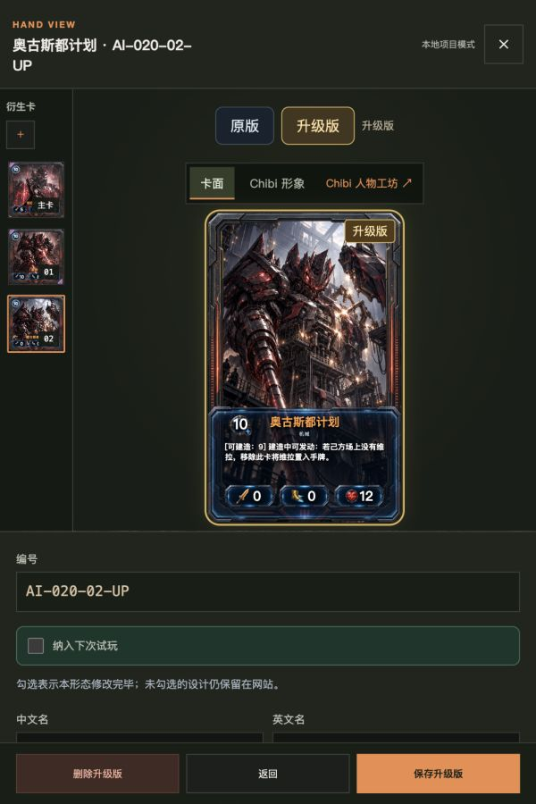

# Website 升级版、事件与试玩标记验收

## v0.3：原版与升级版绑定试玩选择（2026-11-26 用户修正）

本节替代下方 v0.2 的独立形态标记验收；下方保留为历史记录。原版为试玩选择权威，升级版自动跟随，新升级继承原版选择；衍生卡与自己的升级版是独立组，事件独立选择。升级页不再提供第二个可编辑开关。

- 数据合同、创建、加载规范化、服务端保存与正式导出共同遵循绑定规则。原版 true / 升级旧 false 会包含两者；原版 false / 升级旧 true 不会反向纳入原版。
- UI 回归覆盖勾选与取消、升级文本旧草稿不回退共用选择、保存升级文本不提交原版未保存开关、失败时恢复配对状态、衍生组及事件独立。
- 独立审阅收紧升级 edit 请求的权限：不能借修改升级文本更改原版选择，仅原版 edit 允许同步其升级镜像。
- 合并代码在隔离的147卡基线执行完整 Website 回归；浏览器在单独4329副本验证原版取消→保存→升级跟随、重新勾选→保存→刷新后跟随，未使用用户4328工作数据进行试验写入。构建、语法和diff检查通过。
- 本地用户设计库为232条；48张升级标记按对应原版同步后，134条纳入（含51个升级版、31个事件），没有配对状态冲突。该设计库和用户插画继续留在工作树，不混入本次编辑器修正提交。
- 编辑器新增军队选项；卡文与规则确认在用户设计数据/原规则草稿中保存。Unity未修改。

## v0.2 历史验收

任务：[Unified #166](https://github.com/Time-Block-Hero/time-block-hero-unified/issues/166)。Website 基线：`aed7d703966aa36a42341b53a06e69864a86db49`。用户批准范围：先完成 Website 设计能力；事件无升级形态；现有卡全部 false，各形态独立标记；不改 Unity。

## 数据与自动验证

- 147 张原卡全部迁移至 schema 6，`playtestReady=false`、`upgradeOfUid=null`。逐张剥离这两个新增字段后，与迁移前卡牌对象完全相等；UID、原始设计、execution 和插画均未改写。没有添加升级样例或事件样例到正式卡表。
- `node tools/migrate-card-designs-v6.mjs --input data/cards.json --check`：通过，重复执行无修改。另存迁移与带备份写入由专门回归覆盖。
- `node tools/sync-cards-from-data.mjs`：生成完整设计镜像、dirty 预览和离线数据，全部 147 张保留。
- `npm test`：166 项通过，0 失败、0 跳过；HTTP 测试在允许 localhost 端口的环境执行。
- `npm run build`、`node --check card-editor.js`、`node --check tools/card-editor-server.mjs`、`git diff --check`：通过。
- 历史执行等价测试显式使用历史 schema 投影或全选测试副本，仍验证原 147 张卡的执行哈希和效果；没有将实际试玩标记改成 true 来通过测试。

新增回归覆盖升级关系、事件限制、独立试玩标记、显式迁移、级联删除、插画引用、共享引用防悬空、HTTP 保存/冲突、形态草稿隔离、保存失败恢复、分类筛选和正式导出选择。

独立审阅发现并修复：未纳入卡的临时上传不应阻断其他卡的正式导出；schema 6 不能通过删除来源修订并篡改 bridge 绕过身份批准。两者均已有可复现回归。最终审阅还发现删除重排等待写入时旧表单可能覆盖另一 UID；现已用统一写入锁及入口守卫修复，新增 7 项异步回归覆盖慢请求、重复操作、false/异常失败恢复和解锁，独立复核无剩余阻断项。

## 浏览器验收

使用本地服务的独立 `/tmp` 测试副本，正式数据未被测试操作污染。桌面尺寸 1365×900，窄窗口 600×900；完成后恢复浏览器原尺寸。

1. 打开星际佣兵：原版标签 false；升级版首次显示未配置。原版输入未保存文本，再创建升级版；升级版独立从已保存原版起步。
2. 升级版输入不同文本并勾选 true；切回原版仍保留原版草稿及 false。仅保存升级版后关闭，提示原版未保存；放弃原版草稿并重开，原版仍是原卡文/false，升级版保留测试文本/true。
3. 升级版金色标识和继承插画显示正常；切换 Chibi 可显示已发布动作控制。修复了新增页签导致卡面离开可视区的布局问题，并在桌面、窄窗口重新检查。
4. 事件分类初始为空；新增事件可编辑文本、保存试玩标签，固定不可收集，无升级入口、无随从攻击/生命/移动控件。事件在不可收集分类中不重复显示；试玩状态筛选有效。
5. 从维拉进入衍生卡奥古斯都计划，创建独立升级版；升级版沿用对应衍生卡插画，默认 false，在窄窗口可编辑并保存。原衍生卡的内容和标签未受影响。
6. 直接读取测试副本保存结果确认以上文本、标记与关系；再次读取正式卡表，仍为 147 张、全 false、无测试形态。
7. 集成最终操作锁后重载浏览器，再保存升级版并切回原版；写入结束后控件恢复可用，原版标签仍为 false。

截图来自测试副本，截图中的 true、升级设计和“验收”文本不属于正式卡牌设计：

## 交付边界

Website 设计备份保留所有卡；正式导出仅选择 true，并检查依赖、执行审阅和批准身份。全 false 时明确报没有纳入的卡，不输出可误用的空游戏内容。新事件和升级形态的游戏执行适配、下一次来源库存批准及 Unity 内容构建均留待后续任务；本次没有修改、启动或验收 Unity。PR 待用户审阅，不自动合并或部署。
