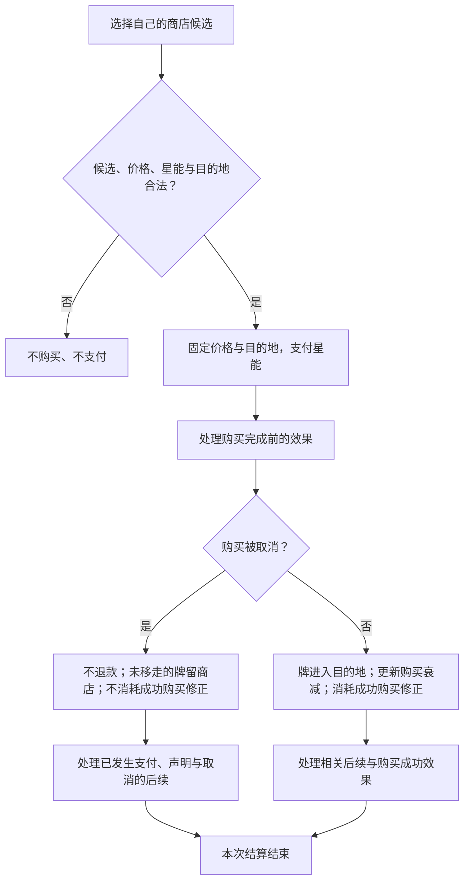

本章说明星能运营、随机商店、购买、三连与删牌。2026-11-26 按用户新规则修订；已明确条款写入正文，尚未确定的数值与交互集中见[本轮待裁定事项](../maintenance/pending.md#三连事件与商店重做边界)。本轮执行所需默认边界已依据2026-11-27实施授权收口；试玩平衡数值仍可在验收后调整。

## 5.1 星能

**ECO-001 星能属于玩家。** 获得星能增加该玩家的余额，支付星能减少余额。星能主要用于购买商店卡牌，也可用于明确要求星能的其他成本；它不是单位的护甲、生命或行动点。

星能跨回合保留，不在回合结束时清空。不能支付超过当前余额的成本，也不能以预期在后续效果中获得的星能提前付款。若一个效果先获得星能、后要求支付，先完成的获得可以用于后续支付。

星能来源由卡牌效果或模式规则规定，例如[资源拾取](lifecycle.md#拾取)。“星之予 I／II／III／IV”分别给予2／4／7／10点星能；它们是无费用事件，不为触发另付卡面费用。普通回合流程不自行附加固定收入、利息或自动补满。模式可规定开局余额与资源生成方案；本章不把标准模式地图上的某种资源数量当成所有模式的收入。

### 5.1.1 购买标价与其他成本

卡牌的星能标价是购买价格的计算基础，不代表放置时再次收取该金额。放置只支付明确写出的独立成本，见[4.2.1](actions.md#放置步骤)。主动能力支付自身明确要求的成本。

“下一次购买减费”只修正符合其条件的购买，不降低任意星能支付。

## 5.2 商店候选与抽取

**ECO-002 随机商店。** 普通商店默认6格，不再从定量额外卡组取出预先配置的实体牌。玩家构筑时选入卡牌种类，该种类即可成为本人的商店候选；同种类可以在对局中再次出现和购买，不受旧同名构筑份数上限限制。商店还包含游戏内置的中立占位卡，见下文。

购买阶段开始时只补现有空位、保留未购商品，购买后不即时补位；此两项沿用原有规则，本轮尚未另作修改。主动刷新重新生成普通格商品。所有普通商品格共用同一套普通／稀有／史诗／传说的基础出货概率，不因格子位置而区分基础或高级货架；这组稀有度概率与费用筛选分别规定，不将“低费”当作“普通”。

### 5.2.1 候选生成与拷贝

**按格抽取与购买衰减。** 普通格按统一基础权重及当前有效限制随机生成候选。衰减按本人的本局累计成功购买记录计算，不按当前持有数量计算。移除到虚空、死亡进入弃牌堆、删除、转交以及三连均不返还购买权重，也不把卡牌回流为待售牌。同屏允许出现同名商品，以支持凑三连；商品出现本身不计购买。

**首次三连保护与线性衰减（2026-11-28确认）。** 累计成功购买某种牌的数量记为 b。已购买0～2张时，该牌的购买衰减系数为1，寻找前三张均不受购买衰减影响；买到第三张之后，后续抽取权重开始线性降低。已购买3～8张时，系数为 `1 − 0.95 × (b − 2) / 7`；已购买9张及以上时，系数保持0.05。

| 已成功购买数量 b | 后续抽取的购买衰减系数 |
| --- | --- |
| 0～2张 | 100% |
| 3张 | 约86.4% |
| 4张 | 约72.9% |
| 5张 | 约59.3% |
| 6张 | 约45.7% |
| 7张 | 约32.1% |
| 8张 | 约18.6% |
| 9张及以上 | 5% |

表内百分比仅用于展示；结算使用上述精确线性公式，不逐次使用四舍五入后的数值。5%是该牌在其他条件相同时保留的相对权重，不是固定的最终出货概率，也不表示有限库存已被买空。

**所有合法候选共同归一化。** 本轮试玩的普通／稀有／史诗／传说基础稀有度权重依次为30／40／24／6，六个普通格一致。先筛出合法种类；每张牌的抽取权重为该档基础权重除以该档合法种类数，再乘构筑系数（选入1，内置但未选入0.5）及购买衰减系数。最后对所有合法牌的权重一起归一化，得到各牌最终出货概率；没有合法种类的档位不占权重。并非先固定各稀有度的最终概率、再只在档内衰减。某种牌被反复购买后，其他合法牌的相对出货概率自然提高，包含不同稀有度的牌；若其他候选也有衰减，各牌最终概率仍取决于全部当前权重。

商店稀有度用于影响出货权重，不等同于战力或前后期定位。商店不随回合或累计消费升级稀有度概率，也没有心愿卡保底。各合法候选保留正权重，不保证在固定刷新次数内出现某一张牌。参数由模式配置提供，不赋予格子不同定位。

**内置中立占位卡。** 普通商店会出现游戏内置的中立占位卡，用于避免玩家只选极少数种类就控制出货。占位候选表由设计师调整，玩家不能查看完整表或修改它；已刷出的商品仍按商店信息权限展示，不能用“表隐藏”隐去当前可购牌的信息。**本轮占位配置已确认：** 先使用本轮已纳入的可收集中立原版作为内置占位候选；未选入玩家构筑、但属于该内置表的中立牌按半权重参与。同一卡同时属于玩家构筑与内置表时不重复计入；购买记录也不因候选入口不同而拆开。本次全中立测试构筑不会额外混入未经审核的新牌。该配置用于抑制极少种类构筑的集中出货收益，实际效果仍须验证，不宣称完全消除所有概率收益。

**特殊上货限制。** 游戏规则或卡牌效果可以限制商店候选，例如“费用低于3”或“只出现传说”。费用筛选读取卡牌原始费用，不读折扣后的购买价格；费用低于3不包含费用3。“零售商之夜”筛选原始费用小于3，“奢侈品之夜”筛选原始费用大于5，减费不改变其入选资格。开局先剔除费用不合格的候选，再对合法候选重新分配概率，不能用超限牌填补没有候选的稀有度。

**限制刷新依次执行（已确认）。** 效果给予的费用／类型限制刷新，按取得顺序逐次应用，不把排队的多项限制同时叠在一次刷新上。例如先取得小于3、再取得大于5的限制，依次处理各自的一次限制刷新，不要求同一批商品同时满足两者。开局费用低于3是整个开局窗口的硬限制。队首限制与它不相容时，该限制留待开局结束后，不因本次开局刷新被消费，也不跳过它去消费后续限制。完全无合法候选时拒绝刷新，不消耗刷新余额、不重置删除机会、不消耗排队限制；不擅自放宽限制。

### 5.2.2 陈列、归属与区域

玩家只能按权限购买自己商店里的候选。展示不等于已经获得套牌中的一张牌；未购商品不计入三连。自己的商品详情可查看，默认不向对手公开，见[2.7](elements.md#公开与隐藏信息)。

构筑种类清单与内置候选表是抽取依据，不是存放实例的游戏区域。商店仍是实际陈列区域；区域划分见[2.6.3](elements.md#额外卡组与商店的区域划分)。普通刷新替换旧候选，不将它们退回已取消的额外卡组；专属格若调取既有实例，依其自己的来源和返还规则。

**重复与三连提示。** 选购时，商品须提示本人的整个套牌中是否已有同名卡，以及买入后是否能凑成三连。计数范围采用[5.6](#三连合成)的四个区域；提示只用于预览，实际购买及合成时仍重新检查。存在合法三连组合时显示三连入口，让玩家查看并选择材料。

## 5.3 商店刷新

**ECO-003 可累计的刷新次数。** 玩家有独立的剩余刷新次数余额，每回合开始获得1次，未使用的次数保留并累积；卡牌或事件效果还可以增加次数。主动刷新成功消耗1次，默认不收星能。按钮明确显示“还剩几次刷新”，不得仅显示本回合是否用过。开局购买另给予1次，见[10.4](../standard/setup.md#初始状态与开局步骤)。

阶段开始的自动补位不消耗主动刷新次数，也不等于额外获得1次；回合开始的次数发放与进入购买窗口是不同节点。刷新次数与费用的明确例外按其规则处理。“银河商道”及其他“获得刷新次数”增加余额，不立即替玩家执行刷新；只有实际成功主动刷新才重置删牌机会。

**货运噗噜兽。** 普通版在购买阶段开始时给予1次额外刷新，升级版给予2次；它不再增加商店格子。新增次数计入同一可累计余额。

### 5.3.1 主动刷新步骤

1. 玩家仍在本人的购买窗口内、尚未声明完成，且至少有1次刷新余额。
2. 检查本次刷新适用的商品限制和格子规则。
3. 替换普通格未购候选，按统一基础概率、购买衰减及上货限制重新生成；专属格按5.3.3处理。成功买到套牌的卡牌不受本次刷新影响。
4. 成功刷新消耗1次余额，并重置本次[删牌机会](#删除卡牌)。不能把一次刷新解释为一次免费的删牌，删除仍花费2星能。
5. 完成刷新相关后续，再继续本人的购买窗口。

新候选可以再次包含曾出现或买过的种类；刷新不保证全部不同。完全没有合法候选时不改变商品、余额、删除机会和排队限制；自动补位无候选则保留空格。玩家声明结束后，本人不能再刷新、购买、三连或删除。

### 5.3.2 商店容量变化

其他效果明确增加普通格时，新增空格不即时补牌，在购买阶段开始上货或主动刷新时填充；购买成功留下的空位同样不即时补牌。不得从货运噗噜兽的刷新奖励推导额外商店格。

容量减少时撤去对应来源提供的多余格，取消其中的普通未购候选，不送回额外卡组。多个扩展格依建立顺序记录，不通过重排商品改变撤去对象。新增普通商品格沿用同一套基础稀有度概率，不能从“多一格”自行推导高稀有度保证。

### 5.3.3 奇莫的虚空专属格

「黑手」供货商-奇莫有效期间额外提供一个专属格，牌源为自己的虚空。上货时随机取一张既有牌从虚空实际移入该格；没有可用牌时保持空置。商品费用减半，按通常费用运算顺序计算并向上取整；该减费只在专属格有效，不给牌附加永久减费。

成功购买默认将该牌送入购买者弃牌堆，买走后不即时补货。主动刷新或下一次购买阶段自动上货时，专属格未购商品先退回虚空，再重新随机进货。奇莫离场、被沉默或效果失效使该格消失时，商品也退回虚空。普通随机格不采用这套返还既有实例的流程。

退回虚空属于移除和逆向转区，按通用规则产生相应事件并清除可重置修正；上货是虚空到商店的正向转区。同一张牌不能同时供两个专属格上货；多个格按建立顺序依次读取当前可用牌源。专属格沿用自身牌源、价格与返还规则；普通随机池的购买衰减及排队筛选不改写它，除非效果明确指定专属格。

## 5.4 购买卡牌

**ECO-004 一次购买取得一张具体候选。** 购买默认把牌送入购买者的弃牌堆。改变目的地的有效例外在支付前确定；购买完成后的效果可以再移动它，但不能追溯改写这次购买原本进入的区域。

### 5.4.1 确定价格与目的地

以该牌的购买标价为基础，应用当前有效且符合条件的费用修正。本稿将最终价格下限设为 0；零费购买仍占用该候选，仍能满足“购买成功”的条件，不会因价格为 0 自动变成生成。

本次价格和目的地在最终检查后固定，再支付星能。只有条件适用于这次购买的修正参与；“下一次成功购买”的修正在购买成功时消耗。

设定值、加减、倍数及取整采用[8.4.1](effects.md#数值运算与读值)；购买价格的小数向上取整。多个目的地例外依其有效性及[替换顺序](effects.md#结算前改写与结算后触发)处理，不按稀有度或界面排列决定。

**商店事件的价格修正（已确认）。** “黑色星期五 I／II”只给事件结算时已经陈列的商品分别减费1／2，修正随该商品离开商店结束，不覆盖之后新刷出的商品，也不成为购入牌的永久原始费用变化。“黑色星期五 III”在本回合为商店商品减费3，包含本回合之后新上货的商品，本回合结束到期。

“至尊黑金卡”使下一次刷新产生的新一批商品购买费用为0；零费只属于这批商品，未购商品继续陈列时保留，离开商店后结束，不让后来另一批商品继续零费。此设定与其他数值修正仍采用上文运算顺序，不改变三连奖励和上货筛选所读的原始费用。

### 5.4.2 购买步骤

以下流程固定为本次试玩结算规则，已支付成本不因取消或失效返还：

1. 选择自己商店中的一张候选，检查本人购买窗口和购买权限。
2. 确定当前价格及适用的目的地例外，检查候选仍存在、星能够付、目的地合法。支付前可以取消，牌和星能均不改变。
3. 提交购买，固定这次价格和目的地，支付星能并声明本次购买。由支付／声明引发的后续暂记，按本流程的专门顺序处理。
4. 处理明确发生在购买完成前的效果。若购买被取消，转入 5.4.3；否则继续。
5. 将该牌移入最终目的地，默认是购买者弃牌堆；该候选不再陈列，普通商品按5.2.1降低该种牌后续出现概率；同时消耗用于本次成功购买的一次性修正。
6. 先处理暂记的支付／声明后续，再处理区域转移及购买成功所引发的后续。若已取消，也须处理已发生支付／声明及取消引发的有效后续，只是不产生购买成功效果。成功后的效果不追溯重算已经支付的价格，也不把已发生的购买撤回。
7. 相关结算完成后，玩家才能继续本人的下一项购买、刷新、三连或删除操作。

**购买的专门时序：** 本流程将支付／声明的后续延至购买成功或取消后，先完成明确的购买前反应；其结算点按[8.5 待结算效果](effects.md#多个效果与连续结算)独立说明，仅适用于购买，放置与主动能力仍使用各自成本时序。

图 5-A 表示一次购买。它不规定双方购买轮流进行；双方操作窗口仍同步开放。取消分支不赋予玩家支付后自由撤销购买的权利。

### 5.4.3 取消与失败

支付前的检查失败：不扣星能，不消费候选或一次性成功购买修正。

**支付后被效果取消：** 已付星能不返还，牌仍留在商店，没有购买成功事实，也不消耗“下一次成功购买”的修正。该结算结束后，若牌仍合法且玩家仍有权限和足够星能，可以另发起一次购买，重新检查和报价。

**失败去向：** 购买被取消或目的地不能接受、且商品尚未离开商店时，牌留在商店；若另一项已完成的效果把它移走，牌留在该效果实际送达的区域，不追回，也不凭空消失。尚未成功的购买不会自动把牌送进弃牌堆。支付后候选离开商店或目的地变非法时，本次购买失败；不消耗“下一次成功购买”的修正，已经支付的成本不退还。

## 5.5 卡组成长与循环

**ECO-005 正常获得牌默认进入弃牌堆。** 购买是获得牌的一种方式；效果只写“获得一张牌”而未明确目的区域时，同样把所得牌放入获得者的弃牌堆。例如“星空奇遇”获得亚空间之门、“决战时刻”获得耐久度设为3的中微子爆弹，均采用此默认。明确写到手牌、直接召唤等按各自文本处理。

进入弃牌堆不等于立即抽到，所得牌等待后续回洗，再经抽牌进入手牌。购买阶段不因取得新牌而开放普通放置窗口；事件本体的触发、结算与消失不是“获得一张循环牌”。

牌组循环见[图 2-B：区域迁移](elements.md#区域迁移示意)；各次转区是否保留修正，统一按[6.5](lifecycle.md#区域转移与状态保留)裁定。

构筑种类清单不会因牌堆耗尽而变成实体牌洗入循环。买到的牌可以循环使用，同名种类仍可由商店再次生成；三连减少循环中的牌数，删牌则按5.8处理。

能否选入构筑依[收集属性](elements.md#收集属性)与模式决定。取得后的存续依基础类型和具体效果；[事件牌](elements.md#事件牌)结算后直接消失，不作为新循环牌进入弃牌堆。

## 5.6 三连合成

**ECO-006 升级版与材料。** 除明确不可升级的卡牌外，可收集与不可收集卡（包括衍生卡）具有对应的升级版，其属性与效果相较原版提升，具体提升内容逐卡定义；事件没有升级版。三张同名卡牌可以合成一张对应升级牌。**升级版不能继续三连**，也不能用升级版与原版混合作为普通三连材料；未来若新增明确“可无限升级”的卡牌，再由该牌规则规定后续升级。升级版须通过游戏层VFX（例如发光或其他清晰外观变化）与原版区分，卡面插画和Chibi动态立绘共用原版素材，不为升级另画资源。升级卡面不额外绘制外层彩色边框，以插画本身的虹光区分；场上升级资源本体同样显示虹光；升级标识不改变卡牌稀有度。英雄与资源牌不参加三连；非资源的衍生牌和其他不可收集普通版，只要位于己方四区域并具有明确升级对应关系，同样可以三连。身份以当前普通版定义对应关系判断，不能仅凭显示名称相同混合不同定义。

**资源牌的升级途径。** 资源牌无论位于牌堆、弃牌堆、手牌或战场，都不能作为玩家三连的材料；场上资源始终中立，不属于己方套牌，不能通过三连收走。资源仍保留升级形态，由明确的卡牌效果生成或取得，例如升级版「矿石扫描」生成升级版「遗失的智慧」。场上资源按[拾取](lifecycle.md#拾取)规则提供收益并消失；不能三连不取消卡牌明确写出的其他效果。

**明确不可升级的例外。** 「飞船失火！」是用于干扰对手的卡牌，明确不可升级，没有对应升级版，也不能作为三连材料。即使己方套牌中凑齐三张或更多张，也不能通过三连将其消耗或清除。此例外不等同于升级数据尚未填写；不扩大为免疫其他合法的卡牌处理方式。

**全套牌检查。** 材料来自[己方套牌中](elements.md#游戏区域)，即本人的牌堆、弃牌堆、手牌和战场，跨这四区累计同名份数，不要求三张都在手牌。商店未购商品、构筑种类清单、内置候选表及虚空不参加本次计数。存在超过三张时，由玩家选择本次要合成的具体三张，不能自动选择或吞掉全部同名牌。

**仅购买阶段执行。** 凑齐三张不会立刻自动合成。购买阶段中购买凑齐、或先前回合通过效果取得同名牌后，均提供三连入口；购买窗口外只形成待合成资格，实际合成与奖励必须等到本人的购买窗口。若等待期间材料离开合法范围，按届时局面重新判断。玩家可以选择何时执行及所需组合，不因按钮出现就立即合成。

**合成后变为普通版（已确认）。** 若升级产物的合成效果要求变为描述中的另一张牌，该产物永久变为所述卡名的普通版，并保留继承的永久效果。此后的同名判断和升级对应关系按新的普通版进行，可以与同名普通牌再次三连；这不授予仍处于升级形态的牌继续三连的资格。每次真实三连各自产生一次奖励，合成效果里的变形本身不额外奖励。

### 5.6.1 选择与合成结果

1. 玩家在本人尚未结束的购买窗口打开三连入口，选择三张合法同名实例；查看对应升级结果。
2. 提交前重新检查三张牌的身份、归属、所在区域及对应升级版；取消选择不改变卡牌。
3. 保存三张素材各自永久获得的额外效果，合成为一张对应升级牌并加入本人的弃牌堆；三张材料退出原区域，不继续作为独立套牌成员。战场材料离开后不再占格，也不再凭原场上来源持续提供箭头或光环。
4. **只继承永久获得的额外效果。** 汇总素材永久获得的效果，例如“永久获得+1攻击／+1速度”。符合永久条件的正负修正均继承；临时buff、外部光环贡献和临时数值不保留。三张素材的基础数值不相加，基础定义取对应升级版。已受伤生命、本回合消耗的移动力与箭头等运行状态不继承；按升级牌的初始化规则建立对应状态，不将合成视为治疗或恢复素材。
5. 合成成功产生[合成时点](#获得与合成时点)，触发对应合成效果，并提供一次[三连事件奖励](#三连奖励与事件)。先完整处理升级产物的合成效果（包含永久变为普通版等后续），再处理最终产物的获得效果，最后给出事件奖励；奖励档位在消耗素材前按原版原始费用固定，不随变形更改。完成本次相关结算后才进行下一项普通操作，尚有合法组合时可再次选择。

**材料消耗与继承边界。** 三连不作死亡或移除判定，不因素材被消耗触发死亡或进入虚空的移除效果。战场来源撤去占格、箭头和持续作用；材料原子消耗，不触发普通离场或弃牌监听；产物是全新的实例，生命、耐久、箭头、行动与建造进度采用升级版初始状态，素材已耗额度与历史状态不迁移。继承内容在处理素材退出前确定，不能先用逆向转区抹掉应继承的永久效果。永久非数值效果沿用[德雷克取得多份效果的兼容规则](lifecycle.md#复制效果)：相同效果分别保留，主动能力各份独立计次，基础攻击范围声明取最大值，多种移动方式分别保留并在行动时选择。圣盾等状态仍按其自身的有／无或叠加规则处理。此处只应用于已经符合永久继承条件的内容，不把素材的全部原生效果或临时效果额外带入；也不沿用德雷克的半属性收益。永久额外效果之外的实例历史不继承，初始化及正常转区仍见[6.5](lifecycle.md#区域转移与状态保留)。

例如三张素材分别永久获得攻击+2、攻击+3、生命上限−1，升级牌继承攻击+5、生命上限−1；若这些修正只是本回合有效，则全部不继承。“未注明期限的buff”不自动等同于明确永久获得的效果。

例如三张同名牌分别在牌堆、弃牌堆和战场，购买阶段可以选择这三张合为一张升级牌进入弃牌堆。只计算材料与产物，不计奖励的后续变化，套牌实例数量净减少2张。该结果不立即抽入手牌，也不在本次购买窗口直接部署。

### 5.6.2 获得与合成时点

**合成时效果（已确认）。** 新增“获得／合成此卡时”的卡牌效果设计入口，区别于“购买此卡时”和“入场”。一张牌合成成功时，只触发升级产物上的“合成此卡时”效果，不触发三张材料上的同类效果；凑齐材料、打开按钮、预览或取消选择都不产生合成成功。合成不能因为产生了升级牌就额外算作购买或入场。

购买、效果生成到套牌和三连产物均是获得；购买成功后结算购买效果，再结算获得效果；三连采用上文合成、获得、奖励的顺序。已有实例的普通转区或控制权转交不自动视为重新获得。正常获得默认入弃牌堆见[5.5](#卡组成长与循环)；不自动让普通转区重复触发获得效果。

## 5.7 三连奖励与事件

**ECO-007 三连奖励。** 每次成功三连，按本次合成原版卡牌的原始费用确定事件稀有度，给出该档三个事件选项，玩家选择其中一个立即触发。费用不相加，不读取购买折扣、临时费用修正或升级后的标价。

| 本次合成原版的原始费用 | 事件稀有度 |
| --- | --- |
| 0–2 | 普通（Common） |
| 3–5 | 稀有（Rare） |
| 6–8 | 史诗（Epic） |
| 9及以上 | 传说（Legendary） |

例如原始费用6、减费后以4星能买到的牌，三连仍奖励史诗事件。事件本身没有费用；不能把奖励档位反写成事件价格。

事件的独立分类、立即结算与消失规则见[2.2.4](elements.md#事件牌)。选择事件不是买到一张进入弃牌堆的新牌。三连奖励之外，卡牌效果可以触发事件；新资源「探险时刻」随机触发一个事件，具体随机池与生成途径待设计。事件触发所在玩家、目标选择及对双方局面的影响须有明确来源，不能因同步购买不存在唯一行动方而选错接受者。

**唯一事件。** 带[唯一](../reference/keywords.md#唯一)的事件，在该玩家确认选择时立即从其本局事件池排除，不等待效果成功结算。仅被展示而未选择不会消耗，也不影响其他玩家的事件池。事件之后因目标失效等未产生全部收益，不撤回已经完成的选择与排除。

**事件选项去重（已确认）。** 一次奖励提供同档中至多三个不同事件，不用同一事件的重复条目补足数量。合法候选只有两个就提供两个，只有一个就提供一个；候选为零则没有可提供的事件选项，不凭空补牌或跨档替代。随机或直接触发唯一事件也在确定该事件时排除；已经使用的唯一事件不能再次随机命中，直接指定已用唯一事件则本次失败，不改抽其他事件。奖励产生新的同名牌或产物变形后可以再次形成三连资格，但须先完成当前结算，再由玩家按5.6选择执行，不自动串连合成。

## 5.8 删除卡牌

**ECO-008 购买阶段删牌。** 玩家在本人购买窗口内可以从套牌中删除卡牌，每删除一张消耗2星能，并消耗1次删除机会。每个购买阶段开始获得1次删除机会，包含开局购买；每次成功主动刷新后，删除机会恢复至1次。未使用的机会不累积，不能跨阶段或通过连续刷新存下多次删除。删除不等于卖出，不返还该牌的购买费用；刷新次数与星能分别记录，刷新本身不免除删除费用。

例如，本阶段尚未删牌时连续主动刷新两次，仍只有1次删除机会；删除后机会为0，再成功主动刷新则恢复为1。再次删除仍须支付2星能。

**范围与去向（已确认）。** 可删除[己方套牌中](elements.md#游戏区域)的非英雄牌，即自己的牌堆、弃牌堆、手牌或战场中的非英雄牌。删除后直接离开本局，不进入虚空或弃牌堆，不触发死亡、弃牌或移除奖励；不能删除对方、无控制者或尚未购买的商品。战场牌被删除后正常撤去占格和持续作用。此操作不同于规则中的“移除”：移除将卡牌送入虚空，删除不留可供回收的本体。删除也不返还已产生的购买衰减。

## 5.9 关联章节

- [回合流程与同步购买](rounds.md#购买)
- [抽牌弃牌与洗牌](lifecycle.md#抽牌弃牌与洗牌)
- [通用结算逻辑](effects.md)
- [标准对战的构筑与开局配置](../standard/setup.md)
- [第五章审阅事项](../maintenance/pending.md#第五章审阅事项)
