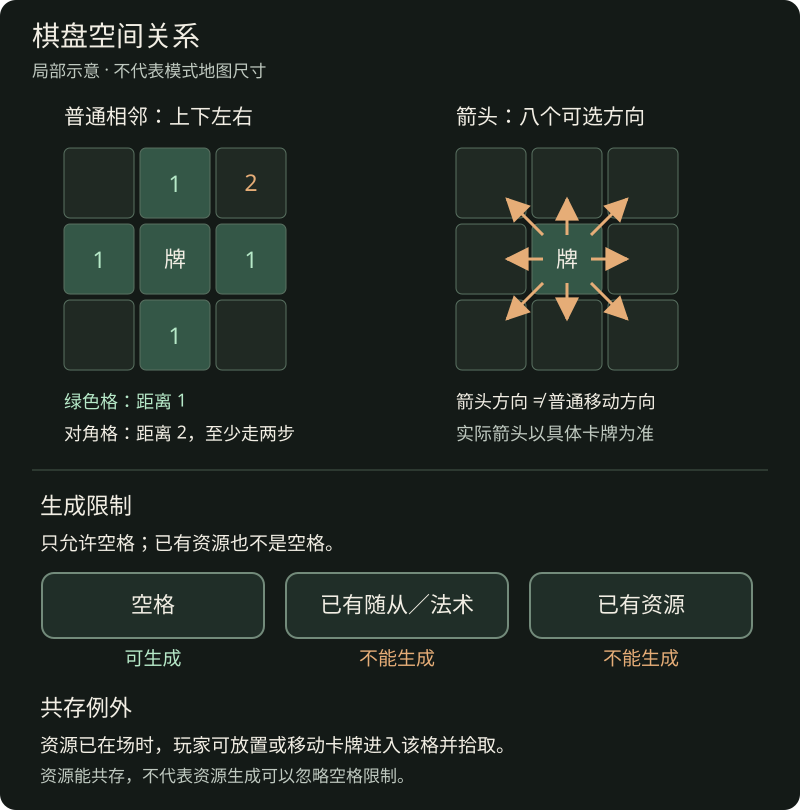
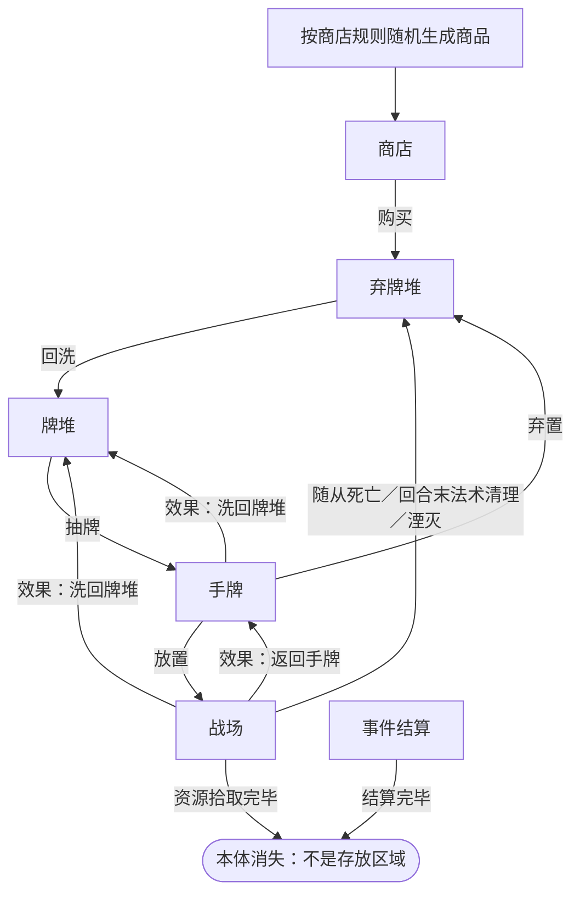
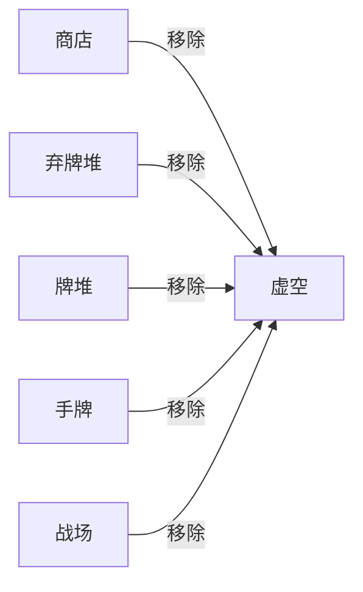

本章说明对象、属性、空间与区域。已确认条款作为裁定依据；本轮规则已固定为试玩基线，集中见[第二章审阅事项](../maintenance/pending.md#第二章审阅事项)。

## 2.1 玩家与控制关系

**ELM-001 玩家、拥有者与控制者。** 玩家是星能、手牌、牌堆、弃牌堆和商店的归属主体。模式规定参与玩家、阵营及对局目标。

**统一归属（已确认）。** 拥有者与控制者表示同一个当前归属玩家，不维护两套不同归属。创建者可作为历史记录，不决定当前操作权、收益或离场去向。归属变化的具体处理见[6.7](lifecycle.md#控制权变化)。

**友方、敌方与非友方（已确认）。** 以某位玩家为参照，该玩家控制的对象属于友方，其他玩家控制的对象属于敌方；非友方包括敌方与无控制者的对象。因此，无控制者野怪是非友方，但不是敌方。对象还须满足卡文的类型筛选，例如“非友方随从”不包含法术、资源或事件牌。

无控制者的野怪指当前没有任何玩家控制的野怪。“无控制者”描述控制关系，职业另按卡牌信息记录。

离场接收玩家、方向与状态继承统一按[6.7](lifecycle.md#控制权变化)处理。

## 2.2 卡牌种类与分类维度

**ELM-002 分类维度。** 可收集与不可收集的普通卡牌采用**随从牌、法术牌、资源牌**三种基础类型；**事件是独立分类**，不作为与这三种基础类型并列的第四种类型，也不归入普通不可收集卡类别。事件不能加入构筑，其独立结算规则见[2.2.4](#事件牌)。“遗失的智慧”与“探险时刻”是资源牌；资源触发的事件与资源本体分别处理。

职业、种族、稀有度、收集属性是相互独立的分类维度。例如，一张牌可以同时是“某职业的机械随从、某稀有度、可收集卡牌”。这些标签本身不附带未写明的战斗能力。

**单位＝随从（已确认）。** 单位包括英雄、建造中的随从及无控制者野怪，不包括法术、资源与事件；需要涵盖所有基础类型时使用“卡牌”。

英雄、野怪等描述身份，不作为与上述三种基础类型并列的其他类型。其他地图物件同样以对应卡牌表示，不能仅凭“物件”名称推断它一定是资源牌或具有随从能力。

### 2.2.1 随从牌

随从牌的卡面信息包含原始攻击、原始移动能力和原始生命等。进入游戏后，每一份具体随从都是独立的卡牌实例，维护当前生命、当前速度、本回合剩余行动点及攻击次数等属性。

- **生成：** 随从可以随初始配置进入对局，也可以由效果生成。效果须指定生成的牌及目的区域；生成到手牌与直接召唤到战场不是同一行为。普通从手牌放置遵守[放置与箭头](actions.md#放置与箭头)，不能把效果生成一律视为普通放置。
- **共存：** 随从是普通占格对象，默认不能与另一随从或场上法术共占一格；可以进入资源所在格，并按[拾取](lifecycle.md#拾取)结算。同格时停部署的冲突在[湮灭](rounds.md#时停结束与湮灭)规则中处理。
- **收益：** 随从通过在战场上的移动、攻击及有效卡牌效果影响对局；进入战场时按[入场](../reference/keywords.md#入场)结算对应效果。随从类型本身不附带拾取收益，击杀野怪的奖励须由其效果或模式另行规定。
- **持续：** 场上随从跨回合留场，不因回合结束自动进入弃牌堆；行动额度按[回合开始](rounds.md#回合开始)刷新。具体效果规定的到期或离场另行处理。
- **离场：** 随从死亡后从战场进入弃牌堆；死亡条件和触发顺序见[死亡与消灭](lifecycle.md#死亡与消灭)。返回手牌、洗回牌堆或移除到虚空，分别按相应效果处理，不能都当作死亡。区域转移时的 modifier 处理见[6.5](lifecycle.md#区域转移与状态保留)。
- **卡组循环：** 构筑选择的是随从种类；开局购买、对局购买或其他效果取得的具体随从按对应规则加入循环；进入弃牌堆后可随回洗、抽牌再次进入手牌，再按条件放置。英雄和野怪的获得途径依[收集属性](#收集属性)及模式规定，不能从“随从”类型推断全部可构筑或购买。

英雄是具有英雄身份的随从，其开局位置、构筑资格和与胜负的关系由模式规定；标准对战的控制权、复制等限制见[9.2.1](../standard/overview.md#英雄的特殊限制与效果设计)。野怪的生成、控制及奖励由对应规则规定；敌我关系按[2.1](#玩家与控制关系)判断。

### 2.2.2 法术牌

法术牌通过效果影响对局，不具有随从牌的原始攻击、原始生命和原始移动能力；未带这些属性，不表示它是一张数值均为零的随从牌。

- **生成：** 法术可以随初始配置进入对局，也可以由效果生成到指定区域。普通从手牌放置遵守[放置与箭头](actions.md#放置与箭头)；生成、取得一张法术，不等于已经放置或已经结算其效果。
- **共存：** 普通放置后的法术占据战场格子，默认不能与另一场上法术或随从共占一格；资源牌的共存例外仍适用。进入资源格时引用[拾取规则](lifecycle.md#拾取)；时停同格冲突按[湮灭](rounds.md#时停结束与湮灭)处理。
- **收益：** 法术按卡牌文本提供伤害、修正或其他效果；从其他区域进入战场时，按[入场](../reference/keywords.md#入场)触发对应效果。不能把所有法术文本都默认为入场效果，持续、延迟及其他触发仍依具体文本的条件与时点。
- **持续：** 普通放置后作为场上法术存在；完成一次效果不等于本体立即消失。仍在战场的法术于[回合结束](rounds.md#回合结束)的法术清理步骤移入弃牌堆，明示的提前离场或其他例外另行处理。
- **离场：** 回合末法术清理是战场到弃牌堆的转移，不因去向相同就视作随从死亡。返回手牌、洗回牌堆或移除到虚空须有对应规则；modifier 按[6.5](lifecycle.md#区域转移与状态保留)处理。法术清理不等于一次性资源的本体消失。
- **卡组循环：** 构筑选择的是法术种类；通过开局购买、对局购买或其他效果取得具体法术；清理进入弃牌堆后，仍可回洗、抽取、再次放置。具体获得资格依[收集属性](#收集属性)，不由“法术”类型单独决定。

### 2.2.3 资源牌

**ELM-009 资源牌的特殊规则（已确认）。**

资源牌是通过[拾取](../reference/keywords.md#拾取)提供一次性收益的卡牌，通常没有玩家归属。

- **生成：** 资源牌生成或从手牌放置时，位置必须是没有任何卡牌的空格；已有随从、法术或资源的格子均不符合条件。资源不可堆叠。
- **共存：** 随从或法术可以放置或移动到资源所在格，与该资源共存；资源不能反过来生成或放置到已有卡牌的格子，也不能与另一张资源堆叠。共存不免除其他领土、箭头、阶段或明示成本。
- **收益：** 卡面规定[拾取](../reference/keywords.md#拾取)的具体收益，例如获得 1 星能；资格与收益接受玩家按该词条判断，数值不由资源类型统一规定。
- **持续：** 战场上的资源牌不会在回合结束时消失，也不参加场上法术清理；未被玩家拾取时继续留在原处。默认只有被玩家拾取才消失。
- **离场：** 拾取完毕后，资源牌直接移出游戏，无论是否具有拥有者，都不进入任何玩家的虚空、手牌、牌堆或弃牌堆。只有拾取效果产生的结果继续存在，例如玩家获得的星能。具体流程见[拾取与移出游戏](lifecycle.md#拾取)。
- **卡组循环：** 通常资源牌不进入玩家手牌、牌堆或弃牌堆；若某个效果将其送入这些区域，则按所在区域的正常规则参与卡组循环。玩家可以将手中的资源牌按正常条件放置到战场空格，它仍保持资源牌类型及上述单向共存规则，不因此变成法术牌；区域转移的 modifier 同样按[6.5](lifecycle.md#区域转移与状态保留)处理。

资源从手牌放置后被另一张牌重叠拾取的案例，见[4.2.2 放置与拾取](actions.md#放置与拾取)。

“回合结束不消失”针对战场上的资源牌，不免除资源牌在手牌中通常适用的弃牌规则。

特殊资源放置的交互边界见[资源牌剩余边界](../maintenance/pending.md#资源牌剩余边界)。

### 2.2.4 事件牌

**事件牌（本轮确认）。** 事件独立于可收集／不可收集卡分类，不能加入构筑，没有星能费用，也没有升级形态。事件只有普通、稀有、史诗、传说四档稀有度，用于奖励分级；不能把稀有度当成需要支付的费用。触发后立即为本次事件的受益玩家结算，完成后本体消失。事件与触发它的卡牌或资源分别记录：例如拾取“探险时刻”会触发一个随机事件，资源本体仍按资源拾取规则处理。

- **生成与触发：** 本轮有三种入口：三连奖励从三个对应等级事件中选择一个触发；卡牌效果触发；资源牌“探险时刻”随机触发一个事件。奖励等级与候选选择见[5.7 三连奖励](economy.md#三连奖励与事件)。
- **共存：** 上述入口直接进入事件结算，不要求玩家先将事件作为普通手牌放置到战场，也不借用随从／法术的占格许可。
- **收益：** 按事件文本立即执行效果。三连奖励由完成三连的玩家选择并获得；“探险时刻”的事件收益由拾取规则确定的收益接受玩家取得。其他效果触发事件时，须由来源明确接受玩家；同步购买中不能凭“当前玩家”推断为某个固定座次或此前的时动玩家。
- **持续：** 事件本体只为本次触发进行结算；事件效果产生的属性变化、资源或后续安排按各自规定持续，不因事件本体消失自动撤销。
- **离场：** 本次结算后事件本体直接消失，不进入弃牌堆，也不进入虚空。事件本体消失不等于随从死亡或弃牌。
- **卡组循环：** 事件不能加入构筑；按本轮三个入口触发的事件不进入抽牌／回洗循环。

事件在独立时停中的“立即”与既有影响限制如何衔接、来源未指定受益玩家及结算失败的处理，见[本轮待裁定边界](../maintenance/pending.md#三连事件与商店重做边界)。

## 2.3 通用属性与各类型专属属性

**ELM-003 卡牌信息（进入游戏前的定义）。** 卡牌信息描述这种牌本身：名称、类型、原始数值和效果文本等。同一种牌的多份拷贝共享这份定义。下表不包含某次对局里才产生的当前数值、进度或计数。

| 属性 | 游戏含义 | 适用与缺省说明 |
| --- | --- | --- |
| 名称与卡牌编号 | 辨认卡牌定义 | 不区分同一牌的不同对局拷贝。 |
| 基础类型 | 普通卡牌采用随从、法术、资源 | 事件是独立分类；身份与职业另外记录。 |
| 职业 | 职业归属，供构筑与效果引用 | 中立是职业分类；不等于无控制者。 |
| 种族 | 供效果引用的一个或多个种族标签，包含新增“军队” | 无种族不等于中立职业；军队不自动赋予阵营或战斗能力。 |
| 稀有度 | 供模式构筑等规则引用 | 不赋予规则优先权或额外战斗能力。 |
| 收集属性 | 可收集卡、衍生卡、不可收集卡或英雄卡 | 决定构筑与获得途径，详见下方专节；与随从／法术／资源基础类型不同；事件另行分类。 |
| 星能费用 | 卡牌的购买标价及相关构筑依据 | 不等于每次放置都再次支付此价格；英雄等特殊身份费用依模式说明，事件没有此费用。 |
| 箭头 | 对指定相邻格提供的放置支持 | 由卡面规定；资源牌类型本身不自动增加或删除箭头，没有箭头就不提供支持。 |
| 箭头需求 | 放置时所需支持数量 | 本稿普通放置默认至少 1 个；例外须明确说明。 |
| 原始攻击 | 随从当前攻击的初始计算依据 | 卡牌信息中的基础数值，不是结算时直接读取的当前攻击。 |
| 基础攻击范围 | 可攻击格子的基础距离范围 | 常规随从默认 1；实际攻击与反击使用各自当前有效范围，见[4.4](actions.md#攻击与反击)。 |
| 原始生命 | 随从生命属性的初始计算依据 | 当前生命和当前生命上限属于卡牌实例，不属于本栏。 |
| 原始移动能力 | 随从当前速度的初始计算依据 | 当前速度与本回合剩余行动点属于卡牌实例。 |
| 效果文本 | 本卡带来的具体行为、条件及例外 | 空白表示没有该卡自带的额外效果。关键词引用统一词条。 |

卡牌文本可以规定建造要求、耐久机制或能力限次；这些是效果规则的描述，不表示卡牌信息本身已经带有一条运行中的进度、剩余耐久或使用记录。

费用的增加、减少和支付见[星能与商店](economy.md)；属性变化与状态保留见[第六章](lifecycle.md)。

### 2.3.1 收集属性

以下收集属性描述非事件卡如何进入构筑或对局，不代替随从、法术、资源的基础类型；事件独立于这套分类：

| 收集属性 | 含义 |
| --- | --- |
| 可收集卡 | 可由玩家将卡牌种类加入构筑，决定普通商店的选牌范围；不在构筑时指定拷贝数量，也不预建初始／额外牌库。具体限制见[第十章](../standard/setup.md)。 |
| 衍生卡 | 由其他卡牌或规则生成、不能直接加入构筑的卡牌；可以按相应效果进入手牌、战场或其他区域。 |
| 不可收集卡 | 地图物件、野怪等系统对象，不能加入玩家构筑；通常不进入商店候选，明确模式例外另行规定。 |
| 英雄卡 | 通过模式的英雄选择或英雄配置进入对局，与普通卡牌种类的构筑途径区分；英雄选择与限制见第十章。英雄在基础类型上仍是随从牌。 |

收集属性不决定一张牌何时离场。**衍生卡不会仅因“衍生”身份自动消失**；它按自身基础类型及具体效果处理，例如衍生随从正常留场，衍生法术遵循回合末法术清理。其他章节直接引用此定义，不从“衍生”二字补出临时存续限制。

### 2.3.2 同名与不同名卡牌

**名称关系（已确认）。** “同名卡牌”指卡名相同的卡牌；“与本卡不同名”指来源卡牌的卡名与本卡卡名不同。按判定时的卡名比较，不按是否为同一个卡牌实例区分。两张同名牌即使是独立拷贝、编号或插画不同，也仍然同名；一张牌自身当然与自己同名。

这是可供卡牌效果重复引用的通用筛选条件，适用于随从、法术、资源和事件牌；敌我归属、区域及其他条件仍须分别满足。例如，天庭乐师的“不同名”计数排除自己及其他天庭乐师，仍可统计归你发动或触发的不同名卡牌效果。没有来源卡牌的游戏流程本身不算一次不同名卡牌效果。

卡牌原始版与升级版须有明确的定义对应关系；升级版的属性和效果采用自己的定义，不能仅由编号后缀推算数值。三连按[5.6](economy.md#三连合成)判断组合及对应升级版。事件无升级形态；合成效果将产物永久变为所述卡名的普通版后，按该普通版重新判断同名三连资格；不将仍处于升级形态的牌作为普通三连材料。

## 2.4 基础属性与对局状态

**ELM-004 卡牌实例（进入游戏后的具体卡牌）。** 一份卡牌进入一局游戏后成为独立实例。实例可以位于牌堆、手牌、战场等区域，不是只有进入战场才成为实例。两份同名牌共享卡牌信息，但各自记录自己的当前属性与状态。

| 实例属性或状态 | 记录内容 |
| --- | --- |
| 实例卡面基础数值 | 以原始定义建立，可按[永久卡面成长](lifecycle.md#永久卡面成长)改变；与modifier、当前剩余值分开。 |
| 当前攻击 | 以实例卡面攻击为依据、应用当前有效修正后的攻击数值。 |
| 当前攻击范围 | 以基础攻击范围为依据、应用当前有效修正后的可攻击范围。 |
| 当前生命与当前生命上限 | 当前剩余生命和此时可恢复的上限；受到伤害减少当前生命，不自动减少上限。 |
| 当前速度 | 实例当前的移动能力；以原始移动能力为依据，受有效效果修正。 |
| 本回合剩余行动点、剩余攻击次数 | 当前尚可消耗的行动额度；消耗行动点不等于降低当前速度。 |
| 剩余耐久 | 部分卡牌具有，消耗及跨循环保留见[6.2.5](lifecycle.md#耐久度)。 |
| 效果进度与完成标记 | 各项进度效果的累计值及一次性完成记录，见[6.2.6](lifecycle.md#进度)。 |
| 跨卡组循环的历史记录 | 例如本局此牌累计被打出的次数，不随清除 modifier 而归零。 |
| 建造进度与完成状态 | 本实例已经积累的进度，以及是否已完成建造。 |
| 能力使用次数 | 本实例在指定统计范围内已经发生的使用记录。 |
| 被保留的回合数 | 回合末实际保留或效果令其被保留一次时增加；正向转区保留、逆向转区清零，见[6.2.7](lifecycle.md#被保留的回合数)。 |
| 所在区域、位置、控制关系 | 本实例当前处于何处、由谁控制。 |
| 护甲、圣盾等状态 | 由相应规则赋予并影响后续结算的状态。 |

这些属性只在适用时记录，不因“成为实例”就自动获得所有表中机制。初始值如何建立、何时刷新、到期或在区域转移后保留，由对应规则规定，不能一律理解为每回合清零。转区处理分为[跨区保留型与逆向重置型](lifecycle.md#状态的转区保留类型)，状态与 buff 的具体归类见[6.5.2](lifecycle.md#特殊状态与-buff-速查)。

例如，两份同名随从的原始生命都为 5；其中一份受伤后的当前生命可以是 2，另一份仍为 5。变化的是各自实例的当前生命，共享的卡牌信息没有因此被改写。明确的[永久卡面成长](lifecycle.md#永久卡面成长)可以改变某个实例自己的基础数值，不改写所有同名牌的原始定义。一次效果指定“这张牌”时，不能用另一份同名拷贝替代。

### 2.4.1 效果关键词与状态

- **效果**规定卡牌如何影响游戏，例如造成伤害、提供持续修正，或在指定条件满足时执行某件事。
- **关键词**是固定效果规则的简写。例如[入场](../reference/keywords.md#入场)说明触发条件，[保留](../reference/keywords.md#保留)说明回合末手牌处理的例外。
- **状态**记录卡牌持续具有的特殊情况、标记或累计数值；状态本身如何影响结算，由相应规则定义。

“具有圣盾”是状态；[圣盾](../reference/keywords.md#圣盾)词条说明该状态如何抵挡伤害及消除。关键词与状态因此可以使用同一个名称。

“耀斑连射每次被保留时增加伤害”是效果；[已经累计的保留回合数](lifecycle.md#被保留的回合数)是状态。这一描述本身不授予该牌“保留”，仍须另有规则使它被保留。

[可建造](../reference/keywords.md#可建造)描述进度如何变化以及完成时如何解锁；当前进度、是否建造完成则属于状态。建造中的白板状态与完成后的属性变化见该词条及第六章。

## 2.5 棋盘与空间关系

**ELM-005 格子、方向与距离。** 棋盘由格子组成，尺寸与双方领地由模式规定。领地表示空间归属，不等于格中卡牌的控制权；进入某方领地也不自动改变控制者。

**相邻与方向（已确认）。** “相邻”指上下左右四格；“相邻 3×3 范围”指围绕中心格的八格，包含斜角、不包含中心格。后者不改变普通格距：两格的距离等于横向格差加纵向格差，斜对角紧邻的两格距离为 2，普通移动至少需要两步。距离不保证存在可通行路径。

“一行”是棋盘横向一整行，“一列”是纵向一整列；卡文“前方／上方”等方向按所属玩家的朝向解释。以自身为参照的“3×3／5×5范围内”以来源所在格居中，默认指范围内的**其他随从**，不影响来源自身；卡文需影响自己时应明确说明。“其他”排除的是来源随从，不能据此把来源所在格从几何范围中删除。卡牌的友敌、种族等筛选继续适用，例如发电站写为“3×3范围内的其他友方建筑随从”，不会给自身加成。

箭头可以指向周围八个方向。因此，箭头指向范围与普通移动的一步范围不同。箭头随卡牌朝向指向具体棋盘格；以该牌所属一方的朝向为基准，双方相对摆放时，箭头相对棋盘旋转半周。控制权改变后按新控制者朝向解释，见[6.7](lifecycle.md#控制权变化)。

**ELM-006 占格。** 本版不设高度。普通单位与场上法术占据格子，默认不能与另一个普通占格对象共存，也不能穿过其格子。资源牌依上文共存例外处理，不阻挡其他卡牌放置或移动到其所在格；进入后按拾取规则判断是否触发。

**空格与完全空格的统一范式（已确认）。**

| 操作 | 候选格的占格要求 | 仅有资源的格子 |
| --- | --- | --- |
| 在场上生成或放置资源 | 完全空格：没有随从、法术或资源 | 不合法 |
| 生成、召唤或放置随从；放置法术；随从移动或瞬移 | 空格：没有随从或场上法术 | 合法 |
| 要求选择空格的预备陷阱，例如驱魔师、预判投弹 | 空格：选择时没有随从或场上法术 | 合法 |

上表中的随从包括英雄与建筑。生成N张资源时，在效果规定的合法区域内取N个不同的完全空格，每格生成一张，不能把多张资源分配到同一格。数量不足和批次处理见[4.2.5](actions.md#效果召唤与放置)。选择由谁完成、何时完成，另按效果及[8.2.1](effects.md#选择时点与操作窗口)处理；占格合法不等于授予玩家选择权限。

卡文简写“空格子”时按上述操作范式解释；“完全空格”始终排除全部卡牌。领土、范围、距离、指定方向及卡文明示的额外限制仍须满足。进入资源格后按对应时点处理拾取；仅指定该格设置陷阱，不因此拾取资源。

**指定格子不等于进入格子。** 「科学纪元驱魔师」与「预判投弹」选择的空格要求没有随从（含英雄、建筑）或场上法术，允许已有资源；这是对格子的选择，不要求该格满足普通放牌的领地或箭头条件。独立时停中按选择者可见的场面判断，对方本次时停中新放置的隐藏卡牌不改变可选格子。结算仍查看已选位置届时的随从或法术，并按各自效果处理；驱魔师只检查法术，预判投弹读取随从／法术分支。资源本身不受两者的伤害或湮灭。

普通占格限制与资源牌共存均已确认，不依赖高度。其他共存、穿越或飞行能力必须明确规定，不能从已取消的高度规则补出许可。

图 2-A 只展示本章的空间关系，不表示标准模式的棋盘尺寸。点击图片可打开原图；箭头图中的八个方向表示可配置的方向，不表示每张牌同时拥有八个箭头。

### 2.5.1 直线效果范围

**360°方向选择（已确认）。** 直线效果以发动源所在位置为起点，可以选择任意角度的直线方向，不限上下左右或八向箭头。射线穿过目标所在格即符合直线范围条件，不要求穿过格子中心。

**穿格与阻挡（已确认）。** 射线必须进入目标格的内部，只触碰格边或格角不算穿过。沿射线从来源向外检查，默认在遇到的第一个随从处停止，不区分友方、敌方或无控制者；来源本身不是沿途阻挡目标。法术和资源不阻挡射线。明确的贯穿效果可以改变停止规则，但须自行说明后续目标与伤害的处理。

**射线效果范式：先选方向，执行时命中。** 选择时记录发动源所在格中心为发射原点，并选择360°范围内的方向；准备只确定原点与方向，不锁定当时的随从。默认慢速入场在时停末轮到其正文执行时，读取合并后的当前场面，从记录的原点沿该方向查找第一个随从，再检查它是否符合卡文的目标条件。来源此后移动或离场不改变已经登记的发射原点。

普通慢速射击可以选择暂时没有随从的方向。结算时没有命中随从，或最先遇到的随从不符合卡文条件，则这次射击不造成伤害；不能跳过阻挡者寻找后面的合法对象。原本瞄向某随从的射击可以被对方在本时停新放置的前排随从挡住；若原目标已经离开，该方向上之后出现的首个随从也可以被命中。

「普通的子弹」的首次命中可为任意关系的随从。「日炎枪手」在时动中即时发动，仍要求选择当时首个随从为敌方的合法方向；其选择与正文连续完成，正文仍沿射线查询首个目标，不穿过友方或无控制者随从。明确要求事先存在合法目标或具有其他限制的卡牌，依卡文约束选择；快速射击也在当次正文执行时查询。该范式不改变普通移动、攻击格距或此前的穿格与阻挡定义。

### 2.5.2 箭头层数与点亮

**箭头层数（已确认）。** 一个有效方向有 X 层箭头，就向该方向对应格提供 X 个箭头计数，用于满足放置的箭头需求；建造对箭头的即时消耗与进度累计见[4.2.3](actions.md#建造)。层数不会延长箭头距离，也不产生新的方向；不同来源指向同一格的有效计数相加。放置与建造的条件及流程见[4.2](actions.md#放置与箭头)。其他效果写“每个箭头”同样逐层计数；明确写“方向数”才按点亮方向计数。增加层数只增强已点亮方向，不点亮新方向；减少层数最低为0，降至0则该方向熄灭；移除某方向的箭头会移去该方向全部层数。

**随机点亮（修订）。** 从八个当前不存在箭头的方向中等概率选择一个，为其点亮一层箭头；八个方向都仍存在箭头时，本次不新增方向，也不因此给已有方向叠层。判断方向是否存在不能只看发光：持续性箭头耗尽后仍存在，不能被当作新方向选中；一次性箭头耗尽后视作不存在，若该方向也没有持续性箭头或其他剩余箭头，便可重新被选中。“增加箭头层数”与“点亮新方向”是不同的修正。

### 2.5.3 永续与一次性箭头

**箭头类型（2026-11-26 修订）。** 未标明一次性的箭头为持续性箭头，旧称“永续箭头”；卡文标记“[一次性箭头]”时，该牌指定的箭头采用一次性类型。两类箭头使用时均消耗实际使用的层数：使用1点就减少1层；持续性箭头在每回合开始时刷新，一次性箭头不随回合刷新。

**方向存在与可用层数。** 持续性箭头被消耗至0层后，其方向仍存在，只是本回合无可用层数、关闭发光，下回合可以刷新。一次性箭头被消耗完后视作不存在；同方向仍有持续性箭头时，该方向仍然存在。持续加层光环移出再移回不能返还已经消耗的点数。

**独立消耗与显示。** 按卡牌来源、方向及类型分别记录剩余层数。同一方向可以同时具有持续性与一次性箭头，两者分别消耗；使用上方箭头不影响右方箭头。只有当前有效且尚有剩余的层数提供支持。某方向的可用层数耗尽时，该方向失效并关闭发光；常规1层持续性箭头使用后，本回合不再提供支持，下一回合刷新后恢复。一个类型耗尽不抹去同方向另一类型尚存的支持。

例如，一张牌上方与右方各有1层持续性箭头，用掉上方1层后，上方熄灭，右方仍可使用。同一方向有3层，普通需求1的牌消耗1层后还剩2层。一次性箭头同样逐方向、逐层消耗。

**消耗顺序。** 沿用先持续性、后一次性的支持顺序；同类型多个来源按先入场者优先，逐来源、逐方向扣除所需层数。普通放置的承诺与消费步骤见[4.2.1](actions.md#放置步骤)，建造的即时吸收见[4.2.3](actions.md#建造)。

**消耗状态的生命周期。** 每回合开始，场上持续性箭头恢复本回合可用层数；恢复量受当时仍有效的箭头定义与修正约束，不恢复已被移除的方向或已到期的修正。刷新后若指向仍可施工的随从，立即按建造规则消耗并累计进度，因此不保证刷新后一直发光。一次性箭头不随回合恢复。战场内移动、控制权转移及同一实例原地变身不自动返还两类箭头的已消耗点数。消耗记录随[逆向区域流动](lifecycle.md#状态的转区保留类型)重置；正向转区不额外刷新。变为新实例采用新实例的初始箭头。 用户已再次确认：普通与永久新增的一次性箭头均遵循该转区重置恢复规则；“耗尽后不存在”不表示同一张牌整局永久失去该箭头，也不限定只能重新购买才有使用机会。

**永久授予一次性箭头（已确认）。** “星海点灯 I”永久新增该实例的箭头配置，授予的是一次性类型，不随回合刷新。消耗后的可用层数仍按一次性箭头规则减少；发生规则规定的重置时，按包含永久新增配置的初始状态恢复。三连继承这份永久配置，不继承素材已耗掉的余额。永久配置与当下剩余层数分别记录，不能因“永久”而消耗后立即补回。多份永久授予落在同方向时怎样叠加，以及点亮方向由谁指定，仍见[待裁定边界](../maintenance/pending.md#箭头与建造修订边界)。

本轮仍待裁定的增层交互、效果读值和特殊本格支持见[箭头修订边界](../maintenance/pending.md#箭头与建造修订边界)。

## 2.6 游戏区域

**“己方套牌中”（已确认）。** 指当前归属本人的牌堆、弃牌堆、手牌和战场中的卡牌总范围，不包含未购商品、构筑种类清单或虚空；战场上的对方与无控制者卡牌不属于己方套牌。每名玩家套牌中的英雄唯一，英雄不作为三连材料，也不能通过购买阶段删牌功能删除。未来用另一名高级英雄替换初始英雄时仍须另定例外；“突破自我”已明确为同一英雄原地永久升级，按[6.6.2](lifecycle.md#升级变形与复制)处理，不额外生成或替换英雄身份。

**ELM-007 区域与流转。** 区域说明卡牌当前处于怎样的游戏位置。地图上的移动改变格子，不等于离开战场再重新入场。

| 区域 | 作用 |
| --- | --- |
| 牌堆 | 抽牌来源，通常从顶端依次抽取。其内容与真实抽牌顺序是不同信息。 |
| 手牌 | 可供放置、弃置、支付及保留等规则引用的牌。 |
| 弃牌堆 | 已弃置或按规则离场的牌；牌堆不足时可洗回，继续卡组循环。 |
| 商店 | 陈列当前可以购买的商品；普通商品按商店规则随机生成，不从有限的额外卡组搬入。 |
| 战场 | 单位、场上法术、资源牌与其他地图物件所在的棋盘区域。 |
| 虚空 | 退出正常卡组循环的区域；[移除](../reference/keywords.md#移除)将牌送到这里，通常不能再被抽到或洗回。 |

虚空是存放卡牌的区域；[资源牌拾取后的消失](#资源牌)与[事件结算后的消失](#事件牌)没有目的存放区域，不能在图中接到虚空。构筑的卡牌种类清单及内置商店候选配置不是存放对局卡牌实例的区域。

[抽牌](rounds.md#回合开始)、[购买](economy.md)、[放置](actions.md#放置与箭头)分别规定对应转移。死亡、弃置、移除不是同一个动作，不能因结果都离开当前区域就替换使用。

### 2.6.1 区域迁移示意

图 2-B 展示常见区域迁移。迁移必须由标注的行动或效果引发；商店的上货与刷新流程见[5.2.2](economy.md#陈列归属与区域)。连线本身不授予转移权限。

死亡、法术清理和湮灭虽然都可以将卡牌从战场送入弃牌堆，但不是同一种事件；各自的触发条件与后续效果分别判断。商店购买默认进入弃牌堆，报价、支付及候选更新见[第五章草案](economy.md#购买卡牌)。

**任一其他区域进入虚空都属于[移除](../reference/keywords.md#移除)**，不局限于从战场移除。下图的每条迁移同样需要有效规则或效果，不表示玩家可以任意移除卡牌。

资源被拾取后、事件结算后本体消失，不在虚空继续保存；不能将它们接到移除的分支。场上随从与资源跨回合留场，法术则执行回合末清理，见[卡牌类型](#卡牌种类与分类维度)。三连素材处理与购买阶段删牌按[第五章](economy.md)及其待裁定边界处理，不由本图推定为移除到虚空。

### 2.6.2 区域的正向与逆向顺序

**区域顺序：虚空 → 商店 → 弃牌堆 → 牌堆 → 手牌 → 战场。** 额外卡组不再是本轮规则的游戏区域；普通商店随机生成商品，不构成额外卡组到商店的同级转区。

图 2-C 是[6.5 区域转移与状态保留](lifecycle.md#区域转移与状态保留)的顺序索引，不表示合法迁移路线；modifier 的保留、清除、例外及案例以该节为准。

### 2.6.3 额外卡组与商店的区域划分

**商店与构筑清单（2026-11-26 修订）。** 本轮取消额外卡组。构筑清单只记录玩家选入的卡牌种类，用于确定商店候选；它没有待售卡牌的具体拷贝、区域数量或可回洗实体。普通商店按槽位规则、候选限制、购买后的出现概率变化及内置占位候选生成商品。

商店中的具体商品与玩家已经取得的套牌卡牌分开；套牌范围包括牌堆、弃牌堆、手牌与战场，不包括尚未购买的商店商品。普通刷新不再将未购牌退回额外卡组，已买到的牌也不因刷新返回商店。候选生成、刷新与特殊来源格的例外见[第五章](economy.md)。本节标题保留为原有链接入口。

## 2.7 公开与隐藏信息

**ELM-008 信息权限。** 以下为本版固定权限，保留此前隐藏对手私人区域内容的规则；“界面尚未提供查看”不等于规则禁止查看。

| 信息 | 通常可见范围 |
| --- | --- |
| 星能及手牌、牌堆、弃牌堆数量 | 通常双方可见；时停期间对手星能及各区可见数量均保持冻结基准。 |
| 自己的手牌 | 可查看具体卡牌。 |
| 自己的牌堆 | 可查看内容，不透露真实抽牌顺序。 |
| 自己的弃牌堆 | 可查看内容。 |
| 对手的手牌、牌堆、弃牌堆 | 默认只知数量，明确揭示的内容除外。 |
| 自己的商店候选 | 自己可见；不向对手公开。 |
| 战场 | 通常公开，时停采用下述特殊可见性。 |
| 自己的构筑种类清单及虚空 | 可查看已选种类和自己虚空中的具体卡牌及状态；不展示未来随机上货结果。 |
| 内置中立占位候选表 | 玩家无权查看或修改；由设计师配置。已刷出商品的可见性仍按自己的商店候选处理。 |
| 对手的商店及虚空 | 默认只知数量，不公开具体卡牌及状态；明确揭示除外。 |

自己可查看的具体卡牌也可查看其当前状态；查看牌堆内容不提供抽取顺序。手牌最左／最右按进入手牌的先后确定，新牌追加到右侧，玩家不能通过界面拖动改变规则顺序；效果明确重排时例外。

表中的时停冻结以[3.3 时停](rounds.md#时停)为准；该节定义冻结基准、独立部署与结束揭示。

## 2.8 关联章节

- [构筑与开局配置](../standard/setup.md)
- [状态变化与卡牌生命周期](lifecycle.md)
- [第二章审阅事项](../maintenance/pending.md#第二章审阅事项)
