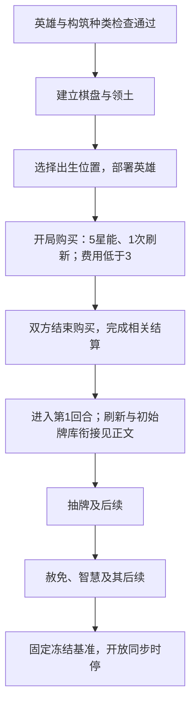

本章采用2026-11-26的新构筑与开局购买规则；2026-11-27依据本轮实施授权补全开局衔接，来源见[维护记录](../maintenance/sources.md#2026-11-27-本轮实施授权与默认收口)。地图与英雄部署沿用现行规则。

## 10.1 英雄选择与构筑限制

**STD-004 每名玩家恰好选择一名英雄。** 英雄决定构筑职业，独立于商店候选种类清单；开局不通过普通购买取得英雄。

玩家将所选英雄职业及中立职业的可收集卡牌种类加入构筑，不再填写每种牌的份数，也不分别配置初始卡组和额外卡组。收集属性见[2.3.1](../common/elements.md#收集属性)；衍生、不可收集牌不能直接选入，英雄单独选择。

这些限制检查对局前的种类清单；对局中由效果取得、生成或转交卡牌，不因此重新检查全部套牌是否仍符合构筑职业限制。

### 10.1.1 同名卡上限

**STD-005 构筑按种类选择。** 同一种牌在清单中只表达“选入这个种类”，不以重复勾选增加出货份数。取消原来按稀有度规定的普通5／稀有3／史诗2／传说1张构筑上限；实际取得多少份由购买、效果与三连决定。

例如，选入「星际佣兵」后，本人的商店就可随机生成该种牌，不需要预先配置三份才能取得三份。种类清单是否有总种类数范围尚待确定；它不沿用已取消的20–30张额外卡组限制。

当前试玩的内容排除继续引用[测试排除名单](../maintenance/neutral-card-audit.md#本轮测试排除)，新升级版与事件的正式内容准入由后续内容设计决定。

## 10.2 初始卡组与额外卡组

**STD-006 初始牌库在对局开局购买形成。** 不再预构筑一副初始牌库，也不构筑定量额外牌库。构筑种类清单只决定商店可出现哪些所选种类；它不是装有这些卡牌实例的区域，不能用来抽牌、弃牌或凑三连。

玩家选定出生位置后，用开局购买形成初始牌库。取消旧有“初始10张、总费用不超过5”的构筑合法性限制；实际能够买入的数量与花费由当时余额、商品和效果决定，不另加初始牌库张数／总费用门槛。开局购买给予5星能和1次刷新，商品费用必须低于3，具体步骤见[10.4](#初始状态与开局步骤)。

默认商店容量、各普通商品格统一的基础稀有度概率、累计获得衰减、内置中立占位牌与可累计刷新次数统一见[第五章](../common/economy.md)。不能通过仅选少数种类来取消内置占位候选。

## 10.3 地图与英雄部署

### 10.3.1 棋盘与领土

**STD-007 标准双人棋盘为纵向 12 行、横向 7 列。** 本章以固定俯视方向从上到下编号第 1–12 行、从左到右编号第 1–7 列；编号不随玩家视角翻转。卡文中的前方、上方和箭头朝向仍按[空间关系](../common/elements.md#棋盘与空间关系)解释。

**每名玩家拥有一块 5×5 领土（已确认）。** 领土后方直接到棋盘边界，不另留空行；左右各保留一列，中央保留两行无归属区域。A 玩家从下方向上，B 玩家从上方向下。布局按[本次确认](../maintenance/sources.md#标准地图去除领地后方空行)调整。

| 区域 | 固定棋盘坐标 |
| --- | --- |
| A 玩家领土 | 第 8–12 行，第 2–6 列 |
| B 玩家领土 | 第 1–5 行，第 2–6 列 |
| 无玩家领土归属的区域 | 左右第 1、7 列，以及中央第 6–7 行 |

领土属于格子，不因随从移动经过或占据它就自动改变。本章所称领土与卡牌当前归属分别判断；领土影响普通放置与资源生成，具体行动合法性仍见[第四章](../common/actions.md)。

### 10.3.2 英雄部署

**STD-008 玩家在己方领土最后一排的合法空格中选择英雄起点。** 按上述地图，A 可选择第 12 行第 2–6 列，B 可选择第 1 行第 2–6 列。

部署作为开局配置完成，不消耗手牌、星能或箭头，也不计入任何回合的普通放置次数。英雄按卡面建立当前生命与行动额度，其生效范围内的持续效果随开局配置生效；开局部署不额外发动一次入场效果。

本稿采用双方同时秘密选择、双方确认后一起公开并完成部署。英雄初始部署完成前，不开放时停或时动操作窗口。部署选择与初始化沿用本轮开局默认值。

## 10.4 初始状态与开局步骤

### 10.4.1 初始区域与数值

**STD-009 开局购买先于第一回合。** 英雄部署完成后，双方进入开局购买窗口，获得5星能及1次刷新。这个购买阶段只出现费用低于3的商品；费用3不符合。限制只描述本次开局购买，不自动延续到以后每个购买阶段。

| 对象 | 开局购买开始时 |
| --- | --- |
| 玩家星能 | 5 |
| 剩余刷新次数 | 1 |
| 战场 | 双方已部署的英雄；不额外预置野怪或资源 |
| 牌堆、手牌、弃牌堆、虚空 | 未由其他明示规则改变前为空；初始套牌通过这次购买形成 |
| 商店 | 按种类清单、内置占位候选及费用低于3的限制上货 |

开局购买使用[同步购买窗口](../common/rounds.md#购买)，不因此开放普通放置、移动或攻击。三连与删除的购买阶段权限同样适用，具体资格和成本见[第五章](../common/economy.md)。本阶段不重复发基础手牌。

### 10.4.2 开局顺序

1. 确定双方席位、英雄与构筑种类清单，检查职业、收集属性和内容准入。
2. 建立12×7棋盘及双方5×5领土，不预先装填实体初始／额外卡组。
3. 双方选择英雄起点，确认后同时完成部署和起始属性建立。
4. 发放开局5星能、1次刷新，按费用低于3的限制生成商店商品，开放双方开局购买窗口。
5. 玩家各自购买和整理套牌，完成本人结算后点击“结束阶段”，结束自己的购买窗口；一方结束不会使另一方提前结束，也不会让游戏提前进入第1回合。只有双方都点击结束且本阶段后续结算完成后，才共同进入第1回合。
6. 第1回合按[回合开始流程](../common/rounds.md#回合开始)刷新、抽牌并完成相关后续，再生成赦免与智慧、固定冻结基准，开放首次时停窗口。

**开局衔接。** 开局买入牌仍进弃牌堆；首次抽牌发现牌堆为空时，按通常洗牌流程将弃牌堆洗回再抽，不提前赠牌。第1回合正常新增1次刷新，与开局剩余余额相加；开局结束时保留未购商品，之后正常补空位或主动刷新。开局低费硬限制在双方结束开局购买后结束。

图10-A展示阶段先后；开局购牌去向及第1回合刷新余额衔接按正文执行。资源生成数量见[11.1](automatic.md#资源生成)。

## 10.5 关联章节

- [模式概览与胜负](overview.md)
- [对局自动逻辑](automatic.md)
- [本轮模式审阅记录](../maintenance/pending.md#第二部分待裁定)
